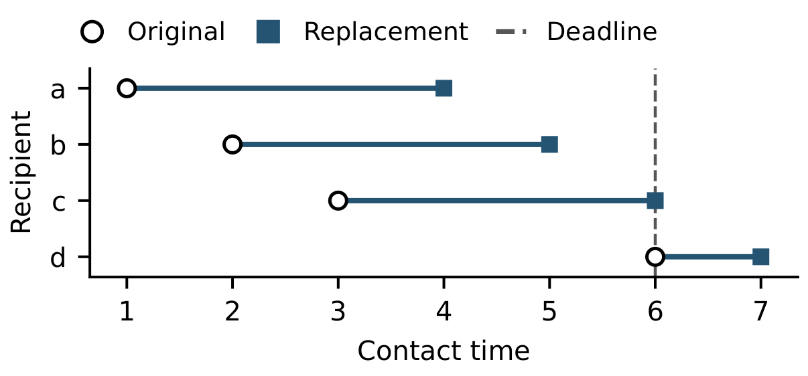

# Output-Sensitive Replacement Arrivals in Temporal Contact Streams

A withdrawal query removes one contact and returns each delayed recipient with its original and replacement arrival times.



## A withdrawal query

Rows in [contacts.csv](data/contacts.csv) are numbered from zero. The first [query](data/queries.tsv) withdraws row 1, the contact from vertex 1 to vertex 2 at time 2, with deadline 7. Two recipients change:

| Recipient | Original arrival | Replacement arrival |
|---:|---:|---:|
| 2 | 2 | 5 |
| 4 | 3 | 6 |

Run all seven queries on x64 Windows with Visual Studio C++ Build Tools and Python 3.10+:

```powershell
.\build.cmd
python run_example.py
```

The component index and the time-expanded dominator index each return the same rosters as chronological replay.

Across 36 source sessions, the component index used less space in 35. The median ratio of expanded to component bytes was **2.48**. On nine logs the corresponding median service-time ratio was **1.03**, with overlapping three-run ranges on every log. [Space](data/session-space.csv) · [Service time](data/matched-runs.csv)

With a 16 MiB budget on Ask Ubuntu, the component index served four interleaved sources with 4 builds. The expanded index built 22 times and local repair built 24 times. All three built four times with unlimited retention. [Cache measurements](data/source-cache.csv)

Run `python run_cache_example.py` after the build to replay the 1 MiB Bitcoin OTC schedule. The script downloads the public ratings file and checks all 512 answers for each method. [Bitcoin OTC at SNAP](https://snap.stanford.edu/data/soc-sign-bitcoin-otc.html)
